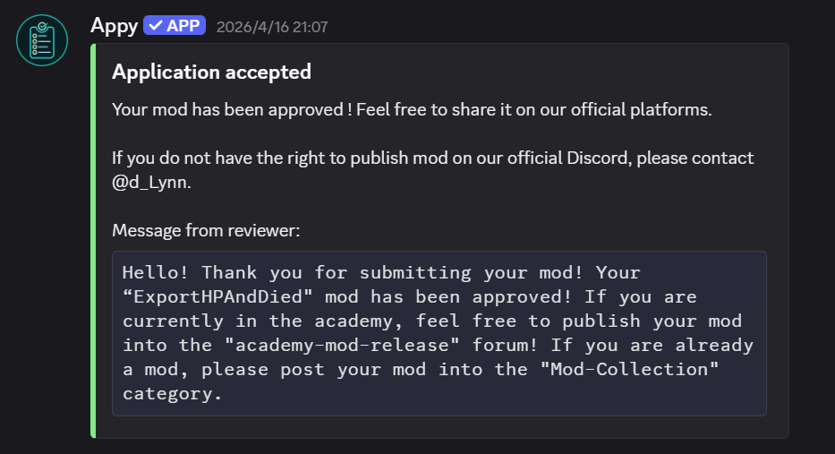

README.md由ai编写 人工修改过  
# test-damage

这是一个用于监控wows（全称~~斯拉夫大牢之一~~World of Warships）伤害日志的项目(监控插件已通过审核)，通过API触发电击，提供沉浸式游戏体验。  
注意: 该项目严重依赖 [Coyote Game Hub](https://github.com/hyperzlib/DG-Lab-Coyote-Game-Hub)   详见 [Coyote Game Hub配置](#coyote-game-hub配置)  

## 项目结构

```
test_Damage/
├── _HasNotBeenConfigured          # 首次运行标记文件
├── apiLoader.py                   # API加载器
├── config.yaml                    # 主配置文件
├── main.py                        # 主程序
├── pyproject.toml                 # 项目配置
├── README.md                      # 项目说明
├── start.bat                      # Windows启动脚本
├── apis/                          # API模块目录
│   ├── api.py                     # API基类
│   ├── dglab/                     # DG-Lab API模块
│   │   ├── config.yaml            # DG-Lab配置
│   │   └── main.py                # DG-Lab实现
│   └── dummy/                     # 测试API模块
│       └── main.py                # 测试实现
```

## 安装

1. 确保已安装Python 3.13或更高版本
2. 克隆或下载项目到本地
3. 运行 `start.bat` 脚本，它会自动安装依赖

## 配置

### 主配置文件 (config.yaml)

主配置文件位于项目根目录的 `config.yaml`，包含以下配置项：

```yaml
# World of Warships游戏安装路径
wows_path: "D:\\SteamLibrary\\steamapps\\common\\World of Warships\\"

# 窗口检测间隔（秒）
window_sec: 0.3

# 震动配置
shock:
    # 使用的API列表
    usingApi: ["dglab"]
    # 每轮命中时增加的强度比例
    addStrengthWhenHitInThisRound: 0.12
```

#### 配置说明：

- **wows_path**: 设置wows游戏的安装路径，确保指向游戏根目录
- **window_sec**: 检测伤害日志的间隔时间，单位为秒。较小的值会更灵敏但占用更多CPU
- **usingApi**: 指定使用的API模块，可选值包括 "dglab", "dummy"(测试用) 等
- **addStrengthWhenHitInThisRound**: 当在当前轮次中命中时，增加的基础强度比例

### DG-Lab API配置 (apis/dglab/config.yaml)

DG-Lab模块的默认配置文件：

```yaml
# DG-Lab API服务器地址
api_url: "http://localhost:8920/"

# 强度分段配置 [伤害百分比, 强度值]
Segment: [
    [0, 10],    # 0%伤害 -> 强度10
    [1, 25],    # 1%伤害 -> 强度25
    [3, 60],    # 3%伤害 -> 强度60
    [5, 85],    # 5%伤害 -> 强度85
    [8, 105],   # 8%伤害 -> 强度105
    [10, 108],  # 10%伤害 -> 强度108
    [15, 125],  # 15%伤害 -> 强度125
    [20, 132],  # 20%伤害 -> 强度132
    [30, 138],  # 30%伤害 -> 强度138
    [40, 142],  # 40%伤害 -> 强度142
    [50, 145],  # 50%伤害 -> 强度145
    [60, 147],  # 60%伤害 -> 强度147
    [75, 148.5], # 75%伤害 -> 强度148.5
    [90, 149],  # 90%伤害 -> 强度149
    [100, 149], # 100%伤害 -> 强度149
    [101, 150]  # 超过100%伤害 -> 强度150
]

# 随机强度范围 [-3, 7] 表示在计算强度基础上随机增减
randomize_strength_range: [-3, 7]

# 是否发送到所有设备
toAllDevices: true

# 强度衰减配置
decay:
  enabled: true          # 是否启用衰减
  interval: 0.3          # 每次递减间隔（秒）
  factor: 0.4            # 每次减少的强度比例
  min_strength: 0        # 停止递减的下限
```

#### DG-Lab配置说明：

- **api_url**: DG-Lab应用程序的API地址，默认本地服务器
- **Segment**: 伤害百分比到强度的映射表，根据伤害比例计算震动强度
- **randomize_strength_range**: 在计算强度基础上添加随机波动，增加真实感
- **toAllDevices**: 是否同时控制所有连接的设备
- **decay**: 强度随时间自动衰减的配置，避免长时间高强度震动

### Coyote Game Hub配置

项目需要配置 [Coyote Game Hub](https://github.com/hyperzlib/DG-Lab-Coyote-Game-Hub)，这是一个游戏集线器。

1. 克隆或下载 Coyote Game Hub 项目
2. 根据 Coyote Game Hub 的文档进行配置
3. 在主 config.yaml 的 `usingApi` 中添加 "dglab"（默认配置完成 但是需要修改apis\dglab\config.yaml中的api_url）

## 运行

1. 确保wows正在运行
2. 运行 `start.bat` 脚本
3. 首次运行会提示配置，请根据上述说明修改配置文件
4. 程序将自动监控伤害日志并触发相应震动效果

## 注意事项

- 首次运行时会显示配置警告，请务必先配置相关文件
- 根据个人耐受度调整强度配置
- 项目仅用于娱乐目的，请注意身体健康 默认配置上限为150 请记得修改

## 依赖

- requests
- aiohttp
- pyyaml

## 许可证

请查看项目许可证文件。